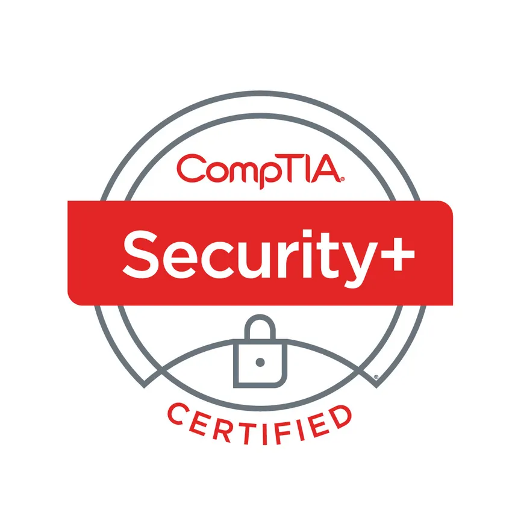
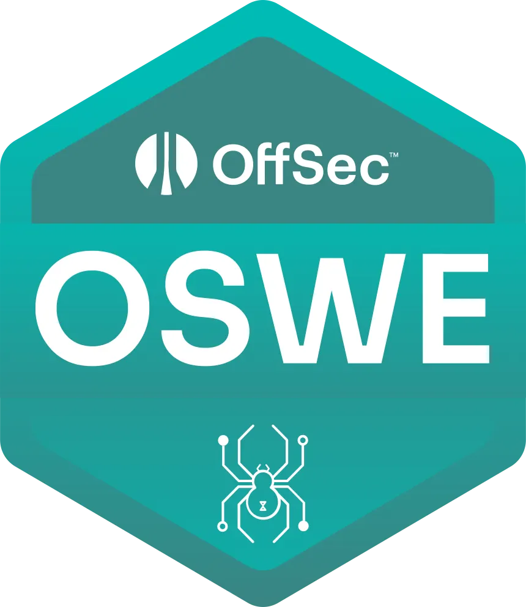
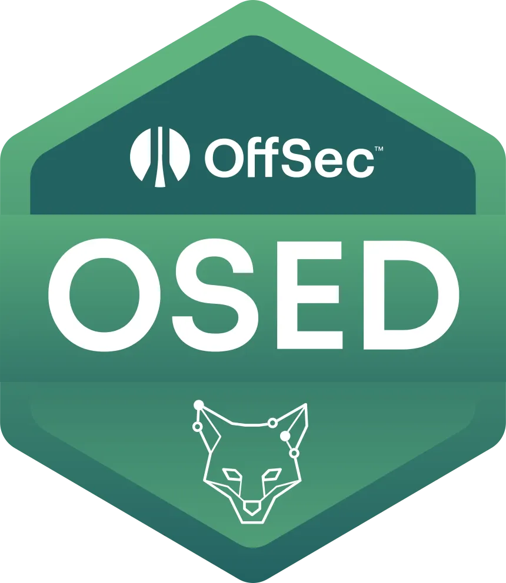
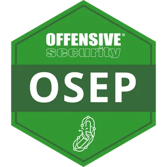
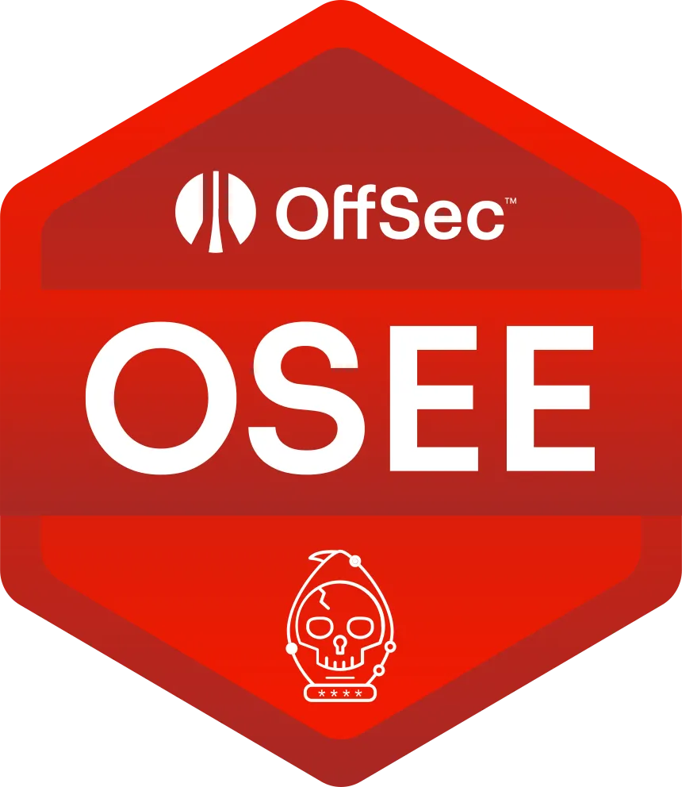

---

## 👻 Hi, I'm 0xGhostShell

---

## 💫 About Me

- 👥  [**Transformers Team**](https://0xghostsh3ll.github.io/transformers_team/)
- 

---

## 🛠 Tools & Languages

---

## 🎓 Certification Goals

| Badge | Certification | Status |
|:---:|---|:---:|
|  | CompTIA Security+ | 🎯 Goal |
|  | OffSec Web Expert (OSWE) | 🎯 Goal |
|  | OffSec Exploit Developer (OSED) | 🎯 Goal |
|  | OffSec Experienced Penetration Tester (OSEP) | 🎯 Goal |
|  | OffSec Exploitation Expert (OSEE) | 🎯 Goal |

---

## 🏆 Profiles

*"The quieter you become, the more you are able to hear."*

